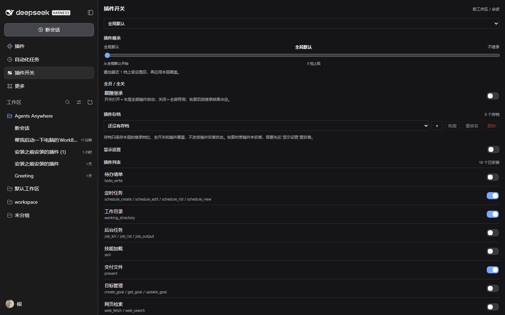

# 插件分区系统 · Plugin Scopes

Switch plugins on or off **per workspace** and **per conversation**, with inheritance from parent scopes, master switches, saved archives, and a sidebar panel to inspect the current scope.

[中文说明](#中文说明) · [English](#english)

## English

### What it does

DSH keeps plugin activation at the profile level, so this plugin works one level below it: it decides, per agent (one agent per conversation), which tools each plugin contributes remain visible to the model, and applies that through `agent.ctx.tools.restrict()` on `agent/created` (plus a backfill for already-running agents). The result is per-conversation isolation for tool-carrying plugins without touching the profile.

- **Inheritance** — each scope (global → workspace → nested workspace → conversation) has a slider:
  - `0` starts from the global default and ignores parents;
  - `1…n` stacks the nearest *n* parent layers, then applies this scope's overrides;
  - `-1` ("do not inherit") starts blank.
  - Unset scopes default to `1` (follow the nearest parent).
  - Workspace nesting is derived from directory containment, because DSH workspaces are a flat list.
- **Master switch** — turn everything on or off for the scope in one click; the switch shows "follow inheritance" when no master state is set.
- **Archives** — save the current scope's inheritance depth, master state and per-plugin overrides as a named archive; restore, rename or delete it later. Archives never change which plugins are installed.
- **Display settings** — show hidden entries and historical (uninstalled) plugins, then reveal or hide each one from the list.
- **Plugin list** — Chinese/English title, one-line description, the tools the plugin registers and a per-scope switch. Plugins without tools (wallpaper, skins, pure UI services) are marked **global**: DSH offers no per-session way to unload them.

### Where to open it

1. Left sidebar → **插件分区系统 / Plugin Scopes** panel; the dropdown selects the scope (global / workspace / conversation).
2. Right sidebar → "new tab" guide → the plugin card opens the current conversation's scope.
3. Every conversation gets its own right-sidebar tab layout, as usual.

### Data

- State: `$DSH_HOME/storages/scope-plugins/<profile>.json` (separate per profile).
- Host HTTP API (same origin):
  - `GET /scope-plugins/api/state?scope=global|workspace:<id>|session:<id>`
  - `POST /scope-plugins/api/rule`, `/archive`, `/display`, `/install`

### Install

Install from the DSH plugin market (search 插件分区系统 / Plugin Scopes), or point `plugin_manager`'s `install_bundle` at this repository directory. After changing code: reload the host plugin (`include:scope-plugins` off/on in the plugin manager) and refresh the page.

### Limits

- Only installed plugins can be switched; removed plugins become "history" and can be reinstalled from display settings.
- Inheritance follows workspace directory containment and `parentSession`, not workspace pin/recency order.
- Switching applies to later turns; conversation history is untouched.
- Plugins without tools cannot be isolated per conversation.

### License

MIT

## 中文说明

按**工作区**和**对话**独立开关插件，支持从上级继承、全开全关、插件存档，并在侧边栏查看当前作用域的启用情况。

### 做了什么

DSH 的插件启停本身是 profile 级，本插件在其下一层工作：在 `agent/created`（并对已有 agent 回填）时，用 `agent.ctx.tools.restrict()` 决定每个会话里各插件贡献的工具是否对模型可见，从而实现按会话隔离，而不改动 profile。

- **继承**：每个作用域（全局 → 工作区 → 嵌套工作区 → 对话）有一个滑块：
  - `0` 从全局默认开始，不读上级；
  - `1…n` 叠加最近 n 层上级设置，再应用本层覆盖；
  - `-1`（不继承）从空白起算；
  - 未设置的层默认 `1`（跟随最近上级）；
  - 工作区的嵌套关系按目录包含推导（DSH 的工作区是扁平列表）。
- **全开 / 全关**：一键开关本作用域全部插件；未设置时显示“跟随继承”。
- **插件存档**：把当前继承档位、全开关状态和单插件覆盖存成命名存档，之后可恢复、重命名、删除；存档不改变插件的安装状态。
- **显示设置**：显示已隐藏项与历史（已卸载）插件，再决定哪些出现在列表里。
- **插件列表**：中文名、一句话介绍、涉及的工具名、右侧开关。没有工具的插件（壁纸、皮肤、纯 UI 服务）标“全局”，因为 DSH 没有按会话卸载它们的手段。

### 入口

1. 左侧栏「插件分区系统」面板：下拉切换作用域（全局 / 各工作区 / 各对话）。
2. 右侧栏「新标签页」指南里的卡片：点开即当前对话的作用域。
3. 每个对话各自一份右侧栏布局。

### 数据

- 状态文件：`$DSH_HOME/storages/scope-plugins/<profile 名>.json`（按 profile 分隔）。
- 宿主 HTTP API（同源）：
  - `GET /scope-plugins/api/state?scope=global|workspace:<id>|session:<id>`
  - `POST /scope-plugins/api/rule`、`/archive`、`/display`、`/install`

### 安装

从 DSH 插件市场安装（搜索「插件分区系统」/ Plugin Scopes），或用 `plugin_manager` 的 `install_bundle` 指向本仓库目录。改代码后：在插件管理器里把 `include:scope-plugins` 关一次再开，然后刷新页面。

### 限制

- 只有**已安装**的插件能被开关；卸载后条目进入“历史”，可在显示设置里重新安装。
- 继承只沿工作区目录包含关系与 `parentSession` 推导，不感知收藏/置顶顺序。
- 开关影响后续轮次，不改变会话历史。
- 无工具的插件无法按对话隔离。

### 许可

MIT
